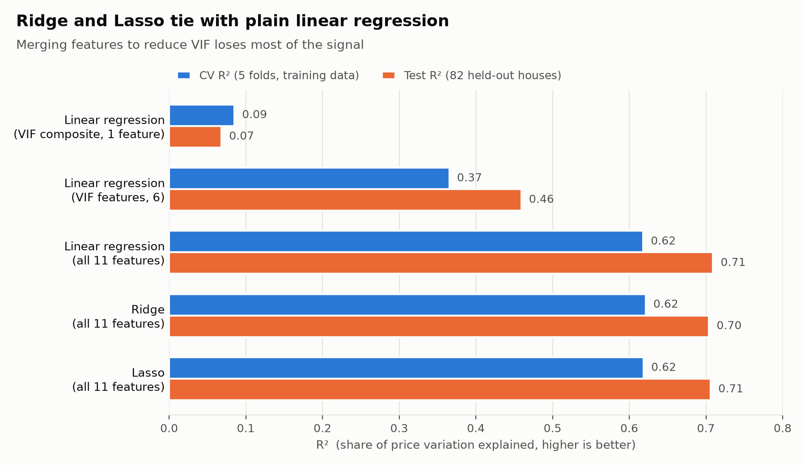

# House Price Prediction

Predicting house prices from size, rooms and amenities, using the [Kaggle Housing dataset](https://www.kaggle.com/datasets/harishkumardatalab/housing-price-prediction): 545 houses, 11 features.

📓 [View the notebook on Kaggle](https://www.kaggle.com/code/kartikpradyumna92/housing-price-prediction)

## The question

Can Ridge or Lasso regression beat plain linear regression on this data?

## What I tried

1. Merged correlated features into a single ratio to lower their VIF (variance inflation factor).
2. Rescaled the data with MinMaxScaler.
3. Compared linear regression, Ridge and Lasso on all 11 original features. I tuned Ridge and Lasso with 5-fold cross-validation on the training data only.

Every model is tested on the same 82 held-out houses.

## Results

| Model | Features | CV R² | Test R² | Avg. error (MAE) |
|---|---|---|---|---|
| Linear regression, VIF ratio only | 1 | 0.09 | 0.07 | 1,543,055 |
| Linear regression, VIF features | 6 | 0.37 | 0.46 | 1,096,866 |
| Linear regression | 11 | 0.62 | 0.71 | 760,710 |
| Ridge | 11 | 0.62 | 0.70 | 767,947 |
| Lasso | 11 | 0.62 | 0.71 | 766,999 |

R² is the share of price variation the model explains (1.0 is perfect). CV R² is the average over 5 folds of the training data.

## Conclusions

- The features barely overlap: every VIF is below 1.5, so there was no real multicollinearity to fix.
- Merging features to lower VIF threw away useful information, and accuracy dropped sharply.
- MinMaxScaler changed nothing, because rescaling doesn't affect linear regression.
- Ridge and Lasso perform the same as plain linear regression, and Lasso keeps all 11 features. The simplest model is the best choice here.
- Expect an R² of about 0.62 on new houses. The 0.71 test score comes from a small test set that happened to be easier than average.
- Predictions are off by about 16% of the average house price.

Built with Python, pandas, scikit-learn, statsmodels and matplotlib.
